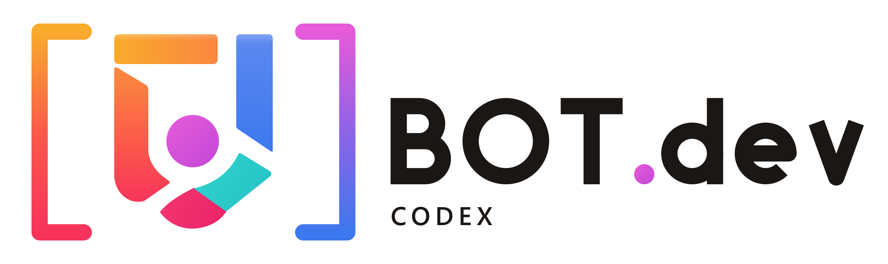

<div align="center">

[EN](docs/CONTRIBUTING.en.md) | **繁中**

<picture>
  <source media="(prefers-color-scheme: dark)" srcset="assets/wordmark-light.png">
  
</picture>

</div>

# 貢獻指南

歡迎回報問題、修正錯誤及補充知識文件。一般貢獻使用 Fork 與 Pull Request；新增技能、改變專案辨識方式或檢查流程前，請先開 Issue 說明目的與相容性。

## 使用 AI 工具

使用 AI 工具協助撰寫、重構或檢查的貢獻，與手寫貢獻一視同仁，不需要標註，也不會因此被拒絕。提交者仍須理解送出的程式碼，並確認沒有安全問題。

## 開發與驗證

執行工具與測試需要 Python 3.11 以上及 Git，不需要額外 Python 套件。倉庫只提供完成的圖像素材，不包含繪製腳本。

```powershell
python -m unittest discover -s tests -v
python scripts/bot_project.py scan --cwd C:\path\to\new_bot
```

新增或修改技能時，檢查 `SKILL.md` 的 YAML、相對路徑與 Codex 實際載入結果。安裝指令見自述文件。

## 程式與文件

- `scripts/bot_project.py` 負責專案辨識與明確呼叫後的檢查；`skills/` 定義 Codex 的使用流程。
- 掃描保持唯讀、離線，不讀取 `.env`、Cookie、Token 或正式資料庫。
- remote、Git 設定與使用者名稱不是權限證明，不能據此自動授權推送。
- 修改辨識或執行流程時，補上成功、失敗與相關邊界情境的測試。
- 新增說明使用中立、自然的敘述。程式註解與給模型的規範用英文；公開文件維持中英文內容一致。
- `knowledge/` 是專案知識快照。內容需能從 BOT. 的程式、貢獻指南、開發指南或 CI 查證；衝突時以 BOT. 現況為準。

## 提交與發布

提交訊息使用 Conventional Commits 前綴與繁體中文主旨，例如 `fix: 修正工作樹辨識`。PR 說明問題、修改後的行為及驗證結果。不得提交憑證、個人資料或執行期產物。

維護者發布前更新 `.codex-plugin/plugin.json` 的版本，執行測試、確認安裝與打包內容，再建立對應的 Git tag 與 Release。公開 GitHub 倉庫與版本發布，不代表已上架 OpenAI 公開插件目錄。

## 授權

AGPL-3.0-only。新貢獻使用相同授權，保留原有著作權與第三方聲明。完整條款見 [LICENSE](LICENSE)。
