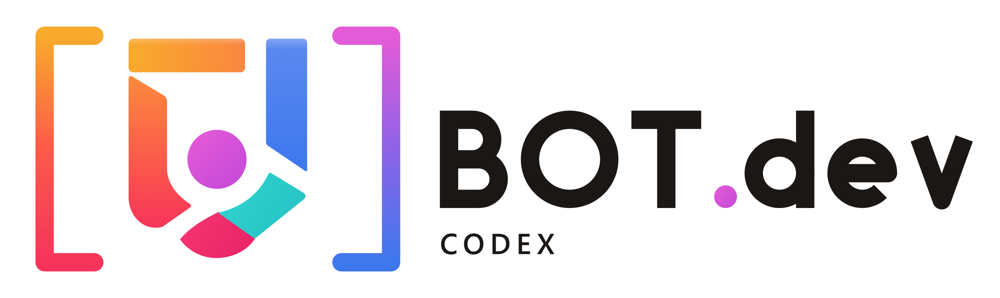

<div align="center">

[EN](docs/README.en.md) | **繁中**

<picture>
  <source media="(prefers-color-scheme: dark)" srcset="assets/wordmark-light.png">
  
</picture>

</div>

# BOT.dev for Codex

協助 Codex 理解 [BOT.](https://github.com/keeiv/bot) 的架構、驗收條件與提交流程，提供專案掃描與檢查工具。需要 Python 3.11 以上與 Git，無額外 Python 套件依賴。

## 安裝

在 PowerShell 執行：

```powershell
codex plugin marketplace add keeiv/bot-dev-codex
codex plugin add bot-dev-codex@bot-dev-codex-local
```

重新開啟 Codex 工作階段後使用：

- `$bot-dev`：依任務載入架構與開發規範。
- `$bot-scan`：掃描版本、Git 狀態、專案關係與模組。
- `$bot-check`：執行 pytest、flake8、black、isort、bandit；不自動格式化、提交或推送。

技能在其他專案仍可被看見，但執行時先檢查 BOT. 指紋，不符就不套用規範。不是 Claude 的 `/scan`，也沒有背景注入系統提示或介面美化 hook。

Git remote、根提交與設定僅作工作流程提示，不構成身分驗證。使用者明確表明自己是維護者，且授權交付時，可以直接推送；貢獻者使用 PR。原生輸出預設英文，回覆語言遵循使用者與 Codex 現有設定，不安裝或發布私人繁中插件。

掃描不連網、不讀 `.env` 或正式資料庫。檢查會執行專案程式並產生 coverage 檔；普通檢查移除繼承的 MySQL 連線與整合測試環境變數。MySQL 整合測試需獨立安排，跳過不可當成驗證通過。

## 開發驗證

```powershell
python -m unittest discover -s tests -v
python scripts/bot_project.py scan --cwd C:\path\to\new_bot
```

知識文件是專案快照，使用時以 BOT. 目前的 CONTRIBUTING.md、docs/DEVELOPMENT.md 與 CI 為準。

開發與提交方式見 [貢獻指南](CONTRIBUTING.md)，完整授權條款見 [LICENSE](LICENSE)。AGPL-3.0-only。
