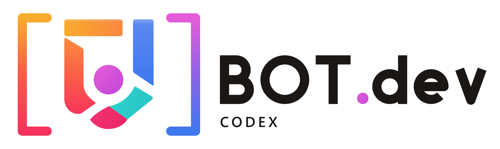

<div align="center">

**EN** | [繁中](../CONTRIBUTING.md)

<picture>
  <source media="(prefers-color-scheme: dark)" srcset="../assets/wordmark-light.png">
  
</picture>

</div>

# Contributing

Issues, fixes and knowledge updates are welcome. Use a fork and pull request. Open an issue before adding skills or changing checkout detection or check execution, explaining the goal and compatibility.

## AI tools

Contributions written, refactored or checked with AI assistance are treated like handwritten contributions. No label is required, and using AI is not grounds for rejection. Contributors remain responsible for understanding the code and ensuring it has no security issues.

## Development and validation

The tools and tests require Python 3.11+ and Git, with no additional Python packages. The repository distributes finished image assets, not artwork generation scripts.

```powershell
python -m unittest discover -s tests -v
python scripts/bot_project.py scan --cwd C:\path\to\new_bot
```

When changing skills, validate YAML, relative paths and actual Codex discovery. See the README for installation.

## Code and documentation

- `scripts/bot_project.py` handles detection and explicitly requested checks; `skills/` defines Codex workflows.
- Keep scanning read-only and offline. Do not read credentials, cookies or production databases.
- Remotes, Git settings and user names are not proof of identity or push authorization.
- Cover success, failure and relevant boundaries when changing detection or execution.
- Use neutral, natural wording. Comments and model-facing instructions are English; keep Chinese and English public documentation aligned.
- Knowledge files are snapshots. Verify claims against BOT. code, contribution and development guides, or CI. The current repository takes precedence.

## Commits and releases

Use a Conventional Commits prefix and a Traditional Chinese subject. PR descriptions explain the problem, resulting behavior and validation. Never commit credentials, personal data or runtime artifacts.

Before release, update the version in `.codex-plugin/plugin.json`, run tests, verify installation and package contents, then create a matching tag and GitHub Release. A GitHub release does not imply listing in the OpenAI public plugin directory.

## License

AGPL-3.0-only. Contributions use the same license and retain existing copyright and third-party notices. See [LICENSE](../LICENSE).
