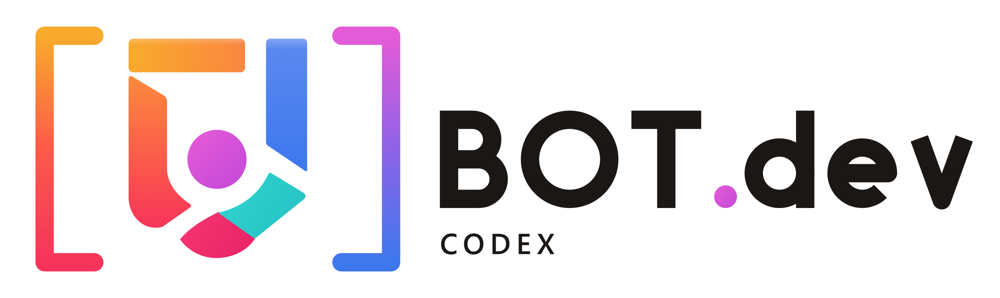

<div align="center">

**EN** | [繁中](../README.md)

<picture>
  <source media="(prefers-color-scheme: dark)" srcset="../assets/wordmark-light.png">
  
</picture>

</div>

# BOT.dev for Codex

A native Codex plugin for the BOT. Discord bot. Python 3.11+, standard library only.

```powershell
codex plugin marketplace add keeiv/bot-dev-codex
codex plugin add bot-dev-codex@bot-dev-codex-local
```

Restart Codex, then use `$bot-dev`, `$bot-scan` or `$bot-check`. Skills are visible globally but gate BOT.-specific behavior on checkout detection. They do not implement Claude slash commands, prompt-composition hooks or UI modifications.

Scan is read-only and offline. Check executes repository code and generates coverage files; it strips inherited MYSQL variables and does not format, commit, push or exercise production services. Report skipped MySQL integration separately.

Repository identity and role hints are not authentication or push authorization. Follow the user's explicit maintenance role and authorized task scope. Existing user language preferences win; bundled output is English. Private Chinese plugins are not bundled.

Run `python -m unittest discover -s tests -v` to test. Bundled knowledge is a snapshot; current repository instructions and CI take precedence. AGPL-3.0-only.

See [Contributing](CONTRIBUTING.en.md) and [LICENSE](../LICENSE).
